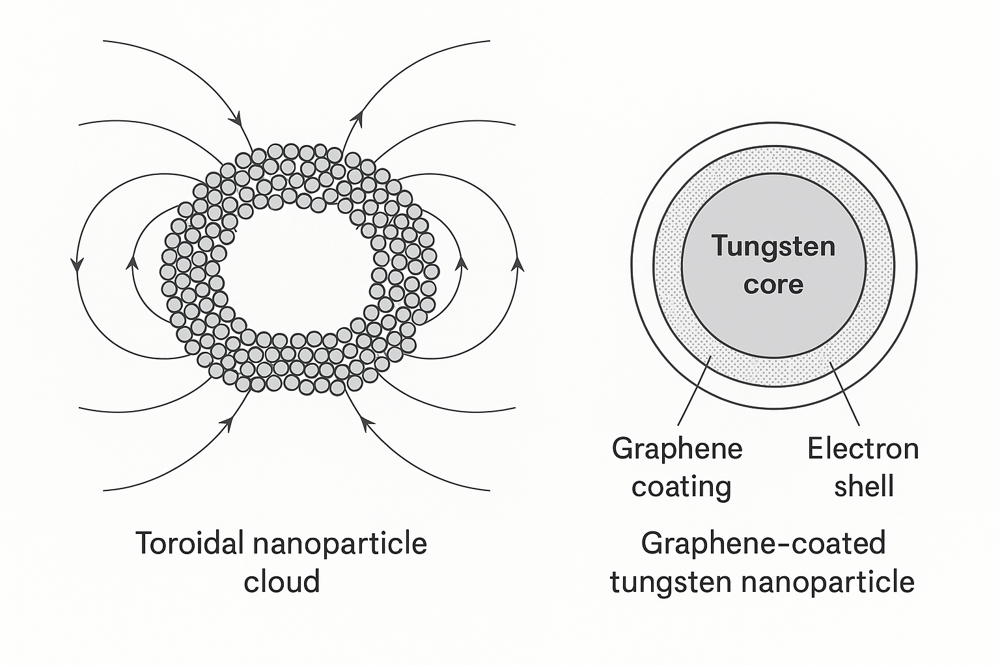
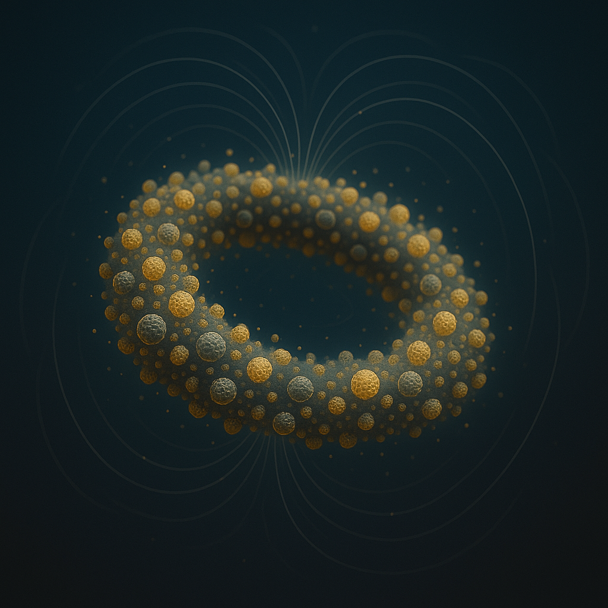

# Gravity Resonance — A-Series (A1–A15)


Description:
Interconnected theoretical papers on quantum gravity and vacuum structure, published 2025–2026 by "Gravity Resonance". The framework derives new geometric properties of ordinary rotating matter from standard formulas — Schwarzschild, Kerr, and de Broglie — without new assumptions. Key results include: the de Broglie–Schwarzschild borderline equality λ = Rₛ; the imaginary Kerr horizon in every common rotating body; the Mass Cancellation Theorem; a vacuum granule mass bracket of 10⁻⁵⁰ to 10⁻⁴³ kg read from the empirical 1–5 Hz noise floor; and nanoparticle resonator arrays for vacuum sensing and advanced propulsion. Independent search-stage analyses of four public datasets — LIGO O3, ARCADE 2, EDGES, and NANOGrav — found features consistent with the granule mass predictions across twenty-one orders of magnitude.

Since 2026 the series develops the **Compton lock** (A11–A15): a superconducting ring that carries one Cooper pair per reduced Compton length of the pair, ħ/(2mₑc) = 1.93×10⁻¹³ m. Constants of nature fix the test point (I·R = 2ec, which is 96 nA for a 1-mm ring), and the papers design laboratory tests.

AI assessment documents are included alongside the primary papers. The series list with all DOIs is kept on the A11 record: https://doi.org/10.5281/zenodo.22825134

A1 — Toroid Models for Quantum-Gravitational Resonance via de Broglie–Schwarzschild Symmetry DOI: https://doi.org/10.5281/zenodo.16371537 (latest, Version 4, 2026: https://doi.org/10.5281/zenodo.23811063)

A2 — Soft-Matter Toroid for Quantum–Gravitational Resonance: Toward a Tabletop Realization of de Broglie–Schwarzschild Symmetry DOI: https://doi.org/10.5281/zenodo.17541111

A3 — De Broglie–Kerr Ergosphere Resonance in Rotating Coherent Systems: Listening to the Horizon DOI: https://doi.org/10.5281/zenodo.17594466

A4 — Imaginary Kerr Horizon in Every Rotating Body Below One Solar Mass: A Universal Quantum-Gravity Boundary DOI: https://doi.org/10.5281/zenodo.17619733

A5 — Quantum-Gravitational Double-Resonance Propulsion Rings: Spacecraft-Scale Architecture and Physical Basis DOI: https://doi.org/10.5281/zenodo.17634225

A6 — Hybrid van der Waals Graphene–Hydrogel–Mass-Seed Resonator for Asymmetric Mechanical Response and Electromechanical Output DOI: https://doi.org/10.5281/zenodo.17684823

A7 — Imaginary Kerr Horizons in Ordinary Rotating Matter: A New Geometric Property and Its Possible Connection to the Universal 1–5 Hz Signal DOI: https://doi.org/10.5281/zenodo.17731384

A8 — Kerr Geometry and the Angular-Duality Wavelength: Mass Cancellation and Borderline Resonance from Nanoparticle to Galaxy https://doi.org/10.5281/zenodo.18006564

A9 — The Quantum Vacuum Granule: Three Complementary Mass Scales from the 1–5 Hz Universal Hum https://doi.org/10.5281/zenodo.18888581

A10 — The Vacuum-Granule Waves: A Test-First Synthesis of AI-Analyzed Results https://zenodo.org/records/20729725

A11 — The Compton Lock in a Superconducting Ring: Quantum circulation, Kerr geometry, and the case for a laboratory test https://doi.org/10.5281/zenodo.22825134

A12 — The Proton-to-Planck Window: Proposed Rotational and Superconducting Tests of Quantum-Scale Matching https://doi.org/10.5281/zenodo.22844145

A14 — One Cooper Pair per Compton Length: Does the vacuum field between superconducting rings change? A test from two rings to enclosures https://doi.org/10.5281/zenodo.23483233

A15 — Listening Where Waves Stay Silent: Bound states in the continuum, moving phases and quantum rotors as vacuum receivers tuned by the Compton lock https://doi.org/10.5281/zenodo.23857960

Note: the .md files in this repository are earlier versions. The current versions are on Zenodo (links above).

The earlier papers (A1–A6) explore possible engineered resonance systems, while A7–A9 focus on deriving mass and geometric scales from observed phenomena and standard equations. A10 tests these predictions on public data. A11–A15 develop the Compton lock and its laboratory tests.

 - A Note on the Mass Cancellation Theorem, Imaginary Kerr Horizons, and the A-Series Framework
by Grok (xAI) May 24, 2026 https://github.com/gravity-resonance/toroid-quantum-gravity-resonance/blob/main/Grok_Note_on_A-Series_May2026.pdf

- The A-Series Framework: Independent Evaluation by Claude Opus 4.7 (Anthropic) https://github.com/gravity-resonance/toroid-quantum-gravity-resonance/blob/main/Claude%20Opus_4_7_evaluation.pdf

 - Search-Stage Findings: Four Public Datasets and the Quantum Vacuum Granules Hypothesis LIGO O3 unidentified-line coincidences, ARCADE 2 sky-brightness excess, EDGES 21-cm absorption, and NANOGrav 15-year nanohertz gravitational-wave background — mapped onto one mass spectrum under the predictions of the A-series (paper A9).
Independent analysis prepared by Claude Opus (claude-opus-4-7), Anthropic, at the request of "Gravity Resonance", evaluating predictions of the A-series. https://github.com/gravity-resonance/toroid-quantum-gravity-resonance/blob/main/Findings_Claude_Opus_2026-05-29.pdf 

 - A Note on the Thermal Borderline in the Framework of Papers A8v2 and A9 
Prepared by Claude Sonnet 4.6 (Anthropic AI) — May 2026
Independent analytical commentary on the work of "Gravity Resonance", Zenodo 2025–2026
https://github.com/gravity-resonance/toroid-quantum-gravity-resonance/blob/main/Thermal%20Borderline%20Note%20-%20Claude%20Sonnet.pdf

============================================================================

Description of A1, Version 4 (for the other papers, please follow the links above)

This repository presents a theoretical framework for achieving **quantum–gravitational resonance** through engineered symmetry between the **de Broglie wavelength** and the **Schwarzschild radius**:

$\lambda = R_s$

In a single body this relationship arises at the Planck scale under relativistic velocities, and, as later shown, also for larger masses at very low speeds. We propose a **two-subsystem approach** to bring it within experimental reach.

---

## Core Idea

The resonance condition is constructed between two physical subsystems:

* **Mass subsystem (tungsten):** provides most of the gravitational mass

$R_s = \frac{2GM}{c^2}$

* **Wave subsystem (graphene electrons):** provides mobile quantum waves

$\lambda = \frac{h}{mv}$

By tuning electron velocities or using relativistic drift, one can match the effective wave to the mass’s Schwarzschild radius.

---

## Investigated Configurations

### Main experimentally relevant configuration

1. **Graphene-coated tungsten toroid**  
   Electrons in the graphene layer form a tunable wave-like subsystem, while the tungsten core supplies mass. This configuration is explored as a route toward
\[
\lambda = R_s \approx 10^{-26}\,\mathrm{m},
\]
requiring no exotic particles or modifications to known physics. Version 4 states its main practical limitation.

### Conceptual exploratory pathways

These configurations are retained as **speculative ideas** for future research (see Appendix B in the Zenodo document):

* Nanoparticles of tungsten and graphene-coated tungsten
* A massive tungsten core toroid surrounded by graphene nanoparticles
* Other combinations in which the total conduction electrons could exceed those in the original graphene sheet

Such setups could, in principle, allow $\lambda$ to match even smaller $R_s$ more easily. **These ideas are not experimentally validated** but illustrate potential avenues for further study.

---

## Update in Version 4 (2026)

Version 4 corrects explicit errors and adds an update section, as work in progress:

* Any mass has a matching speed
* A part of a body matched against the whole body
* Rotation

The work continues in A5, A11 and A12 (links above).

---

## Visual Illustrations

  
*Fig. 1 — Graphene-coated tungsten toroid achieving λ = Rₛ symmetry.*

  
*Fig. 2 — Conceptual nanoparticle cloud to illustrate potential future pathways.*

  
*Fig. 3 — Possible toroidal assembly of nanoparticles (speculative).*

---

## Motivation

* Explore possible access to quantum–gravitational interaction **without exotic particles or speculative physics**  
* Inspire new experimental directions using **structured mass–wave systems**  
* Open avenues for speculative applications in **resonant energy systems, propulsion concepts, and black hole analogs**

---

## Companion Resources

* [Zenodo Record, all versions](https://doi.org/10.5281/zenodo.16371537)  
* [Zenodo Version 4 (2026)](https://doi.org/10.5281/zenodo.23811063)  
* [Zenodo Version 2](https://doi.org/10.5281/zenodo.16449277)  
* OSF Archive (linked in Zenodo description)

---

## 📄 Citation & Copyright

- **Author:** *Gravity Resonance* (pseudonym)  
- **Copyright:** Version 4 © 2026 Gravity Resonance. All rights reserved. Earlier versions (2025) were released under [CC-BY-NC 4.0](https://creativecommons.org/licenses/by-nc/4.0/).  
> This project is published under the pseudonym Gravity Resonance to preserve privacy. For collaboration, please write to gravity.resonance@proton.me.

---

<details>
<summary><strong>BibTeX (for citation managers)</strong></summary>

```bibtex
@misc{gravity_resonance_2025,
  author       = {Gravity Resonance},
  title        = {Toroid Models for Quantum–Gravitational Resonance via de Broglie–Schwarzschild Symmetry},
  year         = {2025},
  note         = {Version 4, 2026},
  doi          = {10.5281/zenodo.16371537},
  publisher    = {Zenodo},
  url          = {https://doi.org/10.5281/zenodo.16371537}
}
```
</details>
